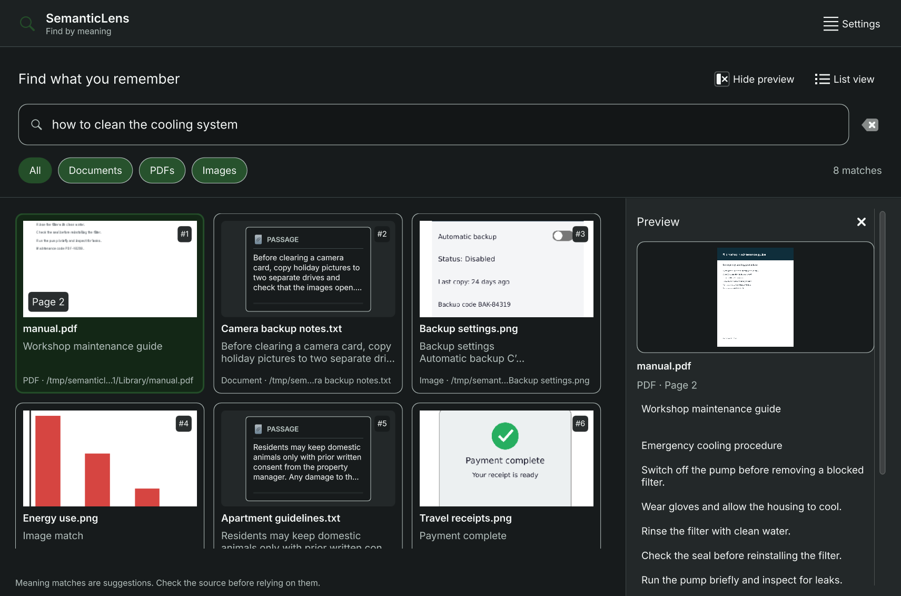

# SemanticLens for KDE v0.1.0-rc2

The second prerelease introduces the native search-first redesign from
[PR #1](https://github.com/Parm-1/semanticlens-kde/pull/1):

- Thumbnail grid and compact list views with file-type filters.
- Persistent image, matching PDF-page and selectable-passage preview.
- Keyboard navigation and a full-width preview for narrow windows.
- Model setup and folder management in Settings, with indexing issues still
  visible in the main workspace.
- KDE desktop controls and the system color palette.

The [native validation](../evidence/redesign-ui-v1/report.md) passed 37 interaction
checks with no QML warnings, plus ten PDF rendering, cleanup and deletion checks.
The [independent media review](../evidence/redesign-media-review-v2/report.md)
resolved its process-ownership finding. The staged compiled interface and the
extracted development package also passed startup/render checks. Hosted CI built
and staged the complete CPU application and loaded the interface without weights
or user data.

Media rendering now uses the adjacent `semanticlens-media` helper and requires
Linux 6.9+ process-group pidfd support. Text results remain available when that
capability is unavailable. The native archive targets the validated Arch x86_64
environment and requires compatible system libraries and CPU instructions; it
contains 22 runtime/notice files, including 13 license/notice files. Model weights
and indexes are excluded. See [BUILD.md](BUILD.md) for dependencies and setup.

Core search, service, ranking, KRunner adapter and the validated CPU embedding
producer are unchanged. The published native producer is reused byte-for-byte;
this release makes no new inference or retrieval benchmark claim. The prior
small authored-corpus results and no-match false positives retain their limits.
The original [rc1 release](RELEASE_CANDIDATE.md) and its evidence are preserved.

[Release assets](https://github.com/Parm-1/semanticlens-kde/releases/tag/v0.1.0-rc2)
include source and native archives, checksums and provenance receipts. Receipts
identify the internal packaging source and tested stage; publication records bind
the exact retained public source to the release tag. Historical source manifests
retain their four explicitly declared system-binary omissions. Assembly
reproducibility means identical archive output from identical inputs, not
bit-for-bit reproducible compiler output.
